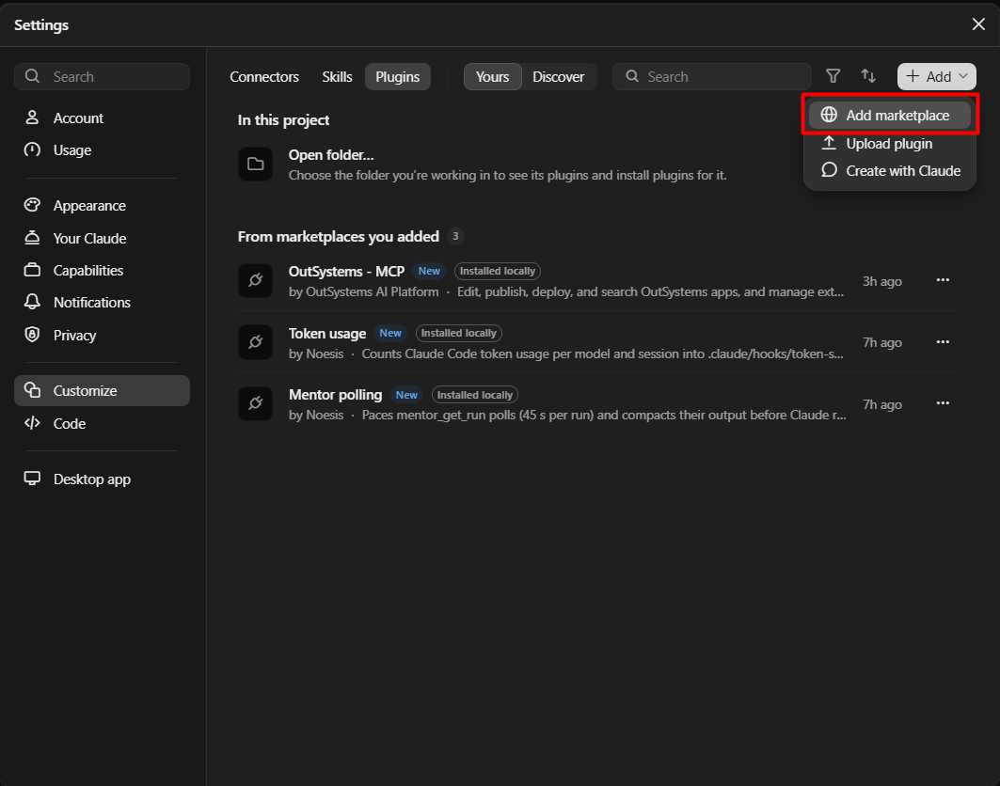
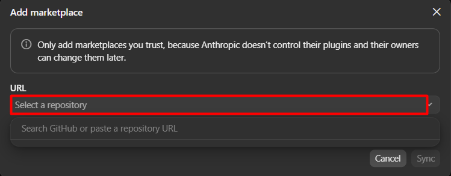

# Instalação, activação e desinstalação

Cada plugin do catálogo `noesis` corresponde a uma capacidade e traz tudo o que ela precisa: a **skill** (instruções que o Claude lê) e os **hooks** com os respectivos **scripts** (código que o Claude Code corre em eventos definidos). Hoje há dois plugins: `mentor-polling` e `token-usage`.

## 1. Requisitos

- **Claude desktop, área Code.** Percurso validado na versão 4.23118.1 da app, que inclui o Claude Code 2.1.321.
- **Acesso ao repositório privado** `DiogoPardal/noesis-claude-skills`. A sua conta GitHub precisa de acesso de leitura, e a máquina precisa de credenciais Git guardadas. O Claude Code usa-as para ler o repositório.
- **Node.js 18 ou superior acessível no `PATH`.** Os hooks correm `node "<pasta do plugin>/scripts/<script>.cjs"`. Sem `node` no `PATH`, as skills aparecem, mas os hooks falham e não há espera, compactação nem contagem de tokens. Para confirmar, corra `node --version` num terminal.

## 2. Instalar pela app (recomendado)

### 2.1 Abrir a gestão de plugins

Numa sessão da área Code, escreva `/plugins` no chat e carregue em Enter. Abre-se a janela **Settings**, em **Customize → Plugins**.

### 2.2 Adicionar o catálogo (uma vez por máquina)

1. Em cima, à direita, clique em **Add** e escolha **Add marketplace**.

   

2. Na janela **Add marketplace**, no campo **URL**, cole `https://github.com/DiogoPardal/noesis-claude-skills`. O campo também permite pesquisar no GitHub.

   

3. Clique em **Sync**.

A app avisa que só deve adicionar marketplaces em que confia, porque o dono pode alterá-los mais tarde. Por isso, as alterações a este repositório passam por revisão (ver [Actualizações e segurança](actualizacao-e-seguranca.md)).

### 2.3 Instalar cada plugin

Depois do **Sync**, o catálogo mostra `mentor-polling` e `token-usage`. Seleccione e instale os plugins de que precisa. Cada plugin é instalado separadamente.

Os plugins instalados aparecem em **Yours**, na secção **From marketplaces you added**, como **Mentor polling** e **Token usage**, com os rótulos **New** e **Installed locally** e um menu **…** em cada linha.

> Por validar: o nome exacto do controlo de instalação no catálogo e as opções do menu **…** não foram registados.

### 2.4 Confirmar que ficou a funcionar

1. Abra uma **sessão nova**. Os hooks são carregados quando a sessão começa.
2. Peça ao Claude para listar as skills. Devem aparecer `mentor-polling:mentor-polling` e `token-usage:token-usage`.
3. **`mentor-polling`:** peça um prompt no Mentor e o acompanhamento do run. Confirme três coisas:
   - a segunda consulta ao mesmo run espera cerca de 45 s;
   - a resposta chega compactada;
   - aparece `.claude/hooks/.mentor-poll-state.json` no projecto.
4. **`token-usage`:** depois de algumas mensagens, pergunte "quantos tokens gastei neste projecto?". O ficheiro `.claude/hooks/token-stats.json` deve existir e estar actualizado.

## 3. Onde fica activo (âmbito)

Instalar um plugin e decidir onde ele fica activo são coisas diferentes. O que decide é a entrada `enabledPlugins` num destes ficheiros de definições:

| Âmbito | Ficheiro | Efeito |
|---|---|---|
| Utilizador | `~/.claude/settings.json` | Activo em todos os projectos desta pessoa |
| Projecto | `<projecto>/.claude/settings.json` (vai para o Git) | Activo nesse projecto para quem o abrir com o plugin instalado |
| Local | `<projecto>/.claude/settings.local.json` (não vai para o Git) | Activo só para si, nesse projecto |

Se o mesmo plugin estiver em mais de um ficheiro, o local prevalece sobre o projecto, e o projecto sobre o utilizador.

**Como confirmar o seu caso:** não se guie pelo rótulo **Installed locally**. Abra os ficheiros acima e procure `"mentor-polling@noesis"` e `"token-usage@noesis"` em `enabledPlugins`. Na instalação feita pela app, com o percurso deste guia, as entradas ficaram em `~/.claude/settings.json`, ou seja, com âmbito de utilizador e activas em todos os projectos.

> Por validar: a secção **In this project → Open folder…** da janela de plugins indica que a app permite instalar plugins para uma pasta concreta. Esse percurso ainda não foi testado.

### Activar só num projecto

Para que um projecto use só algumas capacidades, ponha no `.claude/settings.json` **desse projecto**:

```json
{
  "extraKnownMarketplaces": {
    "noesis": { "source": { "source": "github", "repo": "DiogoPardal/noesis-claude-skills" } }
  },
  "enabledPlugins": {
    "mentor-polling@noesis": true,
    "token-usage@noesis": true
  }
}
```

Este ficheiro diz que plugins o projecto quer, mas não os descarrega. Cada pessoa tem de ter o catálogo adicionado e os plugins instalados na sua máquina (secção 2). Capacidades que não estejam em `enabledPlugins` não ficam activas por este ficheiro. Se estiverem activas no âmbito de utilizador, continuam activas.

## 4. Utilização

Não é preciso invocar nada à mão:

- **Skills:** o Claude lê a descrição de cada skill e usa-a quando o pedido encaixa, por exemplo "acompanha este run do Mentor" ou "quantos tokens gastei?".
- **Hooks:** correm sozinhos nos eventos declarados:
  - `mentor-polling`: antes e depois de cada `mentor_get_run`;
  - `token-usage`: no fim de cada resposta e de cada subagente.

Os hooks escrevem estado no projecto, em `.claude/hooks/`. Acrescente ao `.gitignore` do projecto:

```gitignore
.claude/hooks/.mentor-poll-state.json
.claude/hooks/.mentor-finished-runs.json
.claude/hooks/.mentor-get-run-filter.jsonl
.claude/hooks/.mentor-hook-debug.jsonl
.claude/hooks/token-stats.json
.claude/hooks/*.tmp
```

O código dos plugins fica na cache do Claude Code, no perfil do utilizador. Nada é copiado para dentro do projecto.

## 5. Actualizar

Ver [Actualizações e segurança](actualizacao-e-seguranca.md). Lá distinguem-se a actualização do catálogo, a actualização dos plugins instalados e a sua aplicação numa sessão nova.

## 6. Alternativa: comandos

Os comandos existem em dois sítios diferentes, que não devem ser confundidos.

**Dentro de uma sessão do Claude Code no terminal** (a aplicação `claude` interactiva), escreve-se no prompt:

```text
/plugin marketplace add DiogoPardal/noesis-claude-skills
/plugin install mentor-polling@noesis
/plugin install token-usage@noesis
```

Na app desktop, `/plugins` abre a janela gráfica da secção 2. Ainda não foi validado se estes subcomandos escritos funcionam na área Code da app.

**Numa shell** (PowerShell, bash), com o Claude Code CLI instalado e o comando `claude` no `PATH`:

```bash
claude plugin marketplace add DiogoPardal/noesis-claude-skills
claude plugin install mentor-polling@noesis --scope project
```

O `--scope` aceita `user` (omissão), `project` ou `local` (ver secção 3). Atenção: a app desktop traz o seu próprio Claude Code, mas isso não põe o comando `claude` no `PATH`. Se `claude --version` falhar no terminal, use o percurso pela app.

Para fixar uma tag ou branch, acrescente `#<ref>` ao repositório, por exemplo `DiogoPardal/noesis-claude-skills#v1.0.0`. Sem ref, usa a branch por omissão (`main`).

## 7. Testar alterações a partir de uma cópia local

Para experimentar alterações antes de as enviar para o GitHub, aponte o marketplace para a pasta do repositório. Este passo usa os comandos da secção 6 e não foi validado pela app:

```text
/plugin marketplace add C:\caminho\para\noesis-claude-skills
/plugin install mentor-polling@noesis
```

Para não ter o mesmo catálogo duas vezes, remova antes o marketplace `noesis` que aponta para o GitHub.

## 8. Configuração

| Variável | Omissão | Efeito |
|---|---|---|
| `MENTOR_POLL_INTERVAL_MS` | `45000` | Intervalo mínimo entre polls do mesmo run. Mantenha abaixo de 60 000 (timeout do hook). |
| `MENTOR_HOOK_DEBUG` | não definida | Se definida, grava o **evento completo** (incluindo a resposta do Mentor) em `.claude/hooks/.mentor-hook-debug.jsonl`, sem rotação. Use só para diagnóstico e apague o ficheiro depois. |

## 9. Conflitos a evitar

- **Hooks locais equivalentes:** se o projecto tiver hooks próprios para `mentor_get_run` em `.claude/settings.json`, desactive-os antes de activar `mentor-polling`. Com os dois, a espera de 45 s acontece duas vezes.
- **Outro contador de tokens:** um hook próprio (por exemplo global, em `~/.claude/settings.json`) pode correr o mesmo script que `token-usage` e gravar no mesmo `.claude/hooks/token-stats.json`. Com o mesmo script, os dois partilham a posição de leitura e não contam a dobrar, mas o trabalho é feito duas vezes. Com um script diferente, os totais podem deixar de ser fiáveis. Nesse caso, mantenha só um dos dois.

## 10. Desinstalar

- **Pela app:** na janela de plugins, cada plugin tem um menu **…**. Ainda não foi validado se a remoção é feita por esse menu.
- **Por comandos:** dentro de uma sessão do Claude Code no terminal, `/plugin uninstall mentor-polling@noesis`. Para só desligar sem desinstalar, numa shell: `claude plugin disable mentor-polling@noesis`.

Retire também a entrada de `enabledPlugins` de qualquer ficheiro de definições onde esteja (secção 3). Os ficheiros de estado em `.claude/hooks/` não são apagados automaticamente; apague-os à mão se quiser.
